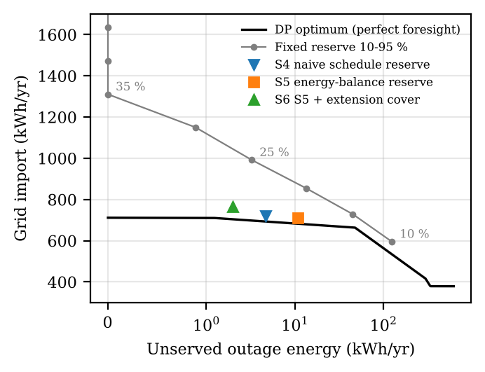

# Look-ahead battery reserve for rooftop PV under scheduled load-shedding (Karachi)

**The question.** A home battery can save money (empty it every evening) or
provide backup (keep it charged). Inverters today offer one setting for this, a
fixed backup reserve. A 2024 Berkeley Lab study of U.S. homes found that in most
circumstances the cost of holding energy in reserve outweighs the backup it
buys, so low reserves are best except where reliability is very poor. Karachi is different:
load-shedding is frequent, and K-Electric publishes the feeder schedule in
advance. Nasir et al. (Energies, 2019) already built a controller for Lahore homes that
uses the known schedule, with a fixed 50 % battery floor. The open questions
are: how much does a fixed reserve or floor waste compared with the best
possible operation, can a simple rule that knows the timetable close that gap,
and what happens when the timetable is wrong?

**What is done here.** A 5.5 kWp PV + 10.24 kWh LFP home system is modelled
from the MPPT and DC-bus control loops up to a full year of hourly operation on
NASA POWER weather for Karachi (2023, 2024, 2025). Every operating rule is
compared with a perfect-foresight dynamic-programming optimum.



## Main results (2025, held out; 2 h/day load-shedding)

| Rule | Outage energy served | Grid import | Above DP optimum |
|---|---|---|---|
| S2 greedy self-consumption | 80.2 % | 595 kWh | 1.3 % |
| S3 fixed reserve, tuned with hindsight (25 %) | 99.5 % | 992 kWh | 40.0 % |
| S4 naive schedule reserve | 99.3 % | 721 kWh | 2.0 % |
| **S5 look-ahead energy-balance reserve** | 98.3 % | **711 kWh** | **1.5 %** |
| **S6 S5 + 1 h extension cover** | **99.7 %** | 766 kWh | 7.9 % |

- S5 on its own falls short of its 99 % calibration target out of sample
  (98.3-98.7 % over 2024, 2025 and the 2-8 h/day cases); the extension cover
  in S6 is what keeps it above 99 %.
- **Load-shedding hours (2 to 8 h/day):** the optimum stays at 711-715 kWh of
  import, and S5 stays 1.5-3.1 % above it. The fixed reserve, re-tuned for each
  case, is 40-92 % above. The naive rule S4 climbs to 59 % above, because it
  reserves for every outage in the next 12 h, even when the sun will refill the
  battery in between.
- **When the schedule is wrong** (100 Monte Carlo years with extended blocks,
  unscheduled outages and load error): S6 serves 98.8 % of outage energy
  (5th percentile 98.2 %) at 776 kWh. A fixed reserve re-tuned with hindsight to
  the same coverage (30 %) needs 1105 kWh, 42 % more. With 2 h extensions
  instead of 1 h, S6 still serves 98.3 %.
- **Battery size:** with 5 kWh, S5 still serves 98.0 % of outage energy (fixed
  reserve 92.2 %, greedy 66.0 %).
- **Ageing** (Wang et al. 2011 LFP cycle model): 3.5 to 3.7 % fade in the first
  year for every rule, so the reserve rule does not wear the battery more.
- **Converter level:** MPPT tested on EN 50530-style ramps; the DC-bus controller
  holds ±1 % for 4-4.5 kW steps; the averaged converter model matches a switched
  20 kHz PWM model within 0.04 V.

S5/S6 have two parameters (forecast margin 1.1, PV derate 0.9), calibrated on
2023 only. 2024 and 2025 are held out.

## Code

| File | What it does |
|---|---|
| `src/pv.py`, `src/mppt.py`, `src/stage1_mppt.py` | single-diode PV (Lambert W), averaged boost, four MPPT trackers, ramp/noise tests |
| `src/battery.py`, `src/stage2_dcbus.py` | 1RC LFP pack, bidirectional DC-DC, cascaded PI + feed-forward, switched-model check |
| `src/inverter.py` | inverter loss model |
| `src/solar.py`, `src/load.py` | NASA POWER loader (with the UTC+4 fix), tilted irradiance, household load |
| `src/ems.py` | all operating rules, outage realisation model |
| `src/dp.py` | perfect-foresight dynamic programming benchmark |
| `src/stage4_annual.py` | annual runs, calibration on 2023, fixed-reserve tuning, battery sweep |
| `src/stage5_research.py` | frontier, load-shedding-hours sweep, Monte Carlo, ageing |

```bash
pip install -r requirements.txt
cd src
python run_all.py        # about 9 minutes; writes figures/ and results/
```

`results/summary.txt` has every number quoted in this README.

## Data

`data/` holds the NASA POWER hourly files for Karachi (24.8607 N, 67.0011 E).
The hour labels in these files (`time-standard=LST`) turned out to be UTC+4,
not Pakistan time; a clear-sky fit gives a +0.47 h solar-time offset, the
longitude difference to 60 E. The code corrects for it.

## Limitations

- The household load is synthetic (appliance blocks driven by the measured
  temperature). There is no public hourly metered data for Karachi homes.
- The load-shedding timetable is stylised, and the extension and unscheduled
  outage rates are assumptions, not fitted to K-Electric data.
- The annual study uses averaged converter models; tariffs, grid
  synchronisation and calendar ageing are not modelled.

## References

- W. Gorman, G. L. Barbose, S. Baik, C. Miller, J. P. Carvallo, "Bill savings vs. backup power: Evaluating operational tradeoffs for home solar+storage systems," Lawrence Berkeley National Laboratory, Oct. 2024. [Link](https://emp.lbl.gov/publications/bill-savings-vs-backup-power)
- M. Nasir et al., "Grid load reduction through optimized PV power utilization in intermittent grids using a low-cost hardware platform," *Energies*, vol. 12, no. 9, 1764, 2019. [Link](https://www.mdpi.com/1996-1073/12/9/1764)
- J. Wang et al., "Cycle-life model for graphite-LiFePO4 cells," *J. Power Sources*, vol. 196, no. 8, pp. 3942-3948, 2011.
- NASA POWER hourly data, [power.larc.nasa.gov](https://power.larc.nasa.gov).

## About

Syeda Tehreem Gillani, FAST-NUCES Karachi. AI-based coding assistance was used
for parts of the software; modelling choices, results and text were checked by
me. License: MIT.
